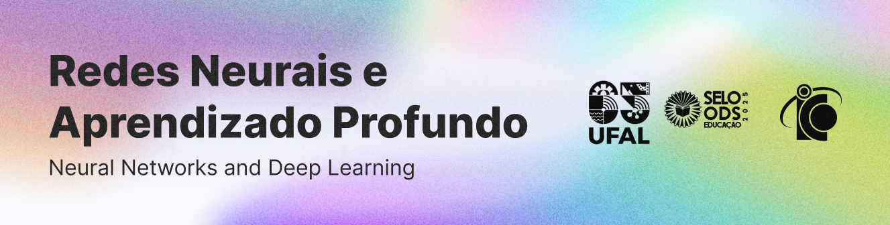

<picture>
  <source media="(prefers-color-scheme: dark)" srcset="./.github/cover.png">
  <source media="(prefers-color-scheme: light)" srcset="./.github/cover_light.png">
  
</picture>

# Task 13 – Inspeção de Cabos IV-CAN

A resolução da atividade, além de estar [disponível neste repositório](./task13.ipynb), também pode ser encontrada no Google Colab:

