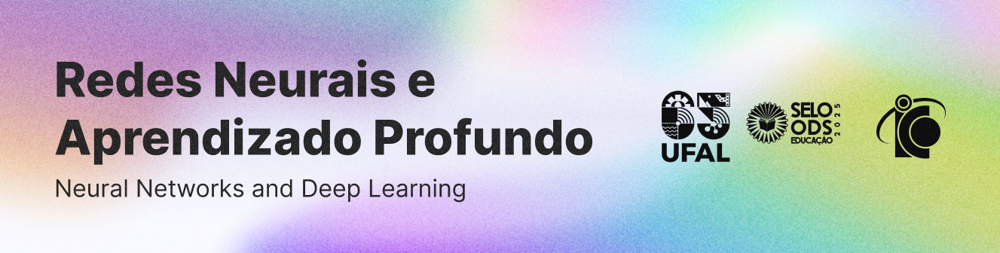

<picture>
  <source media="(prefers-color-scheme: dark)" srcset="./.github/cover.png">
  <source media="(prefers-color-scheme: light)" srcset="./.github/cover_light.png">
  
</picture>

# Task 14 - Redes Residuais

A resolução da atividade, além de estar [disponível neste repositório](./task14.ipynb), também pode ser encontrada no Google Colab:

## ⚠️ Arquivos grandes

O arquivo de pesos pré-treinados `ResNet50.h5.zip` não está incluído no repositório porque seu tamanho excede o limite de 100 MB por arquivo do GitHub.